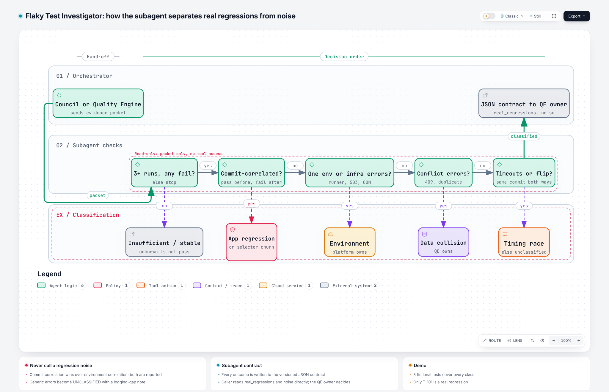

# Flaky Test Investigator

**A read-only subagent that tells you whether a red test is about the product or about the test system.**

[](https://github.com/j-m-o/flaky-test-investigator/actions/workflows/ci.yml)
`Type: Subagent` · `Read-only` · `Tool-agnostic` · `Python stdlib, no network`

Created by **Jessica Mosley** | [LinkedIn](https://www.linkedin.com/in/jessmosley/) | [GitHub](https://github.com/j-m-o/)
Portfolio concept and original framework | Version 1.0.0 | November 2026

## Why I built this

Flaky tests cost twice. Teams chase noise, and worse, they learn to ignore red builds, so the one real regression gets quarantined with the rest and ships. I wanted a specialist that an orchestrator can hand rerun evidence to and get back a defensible answer: **real regression, or which kind of noise, and who owns it.**

It is deliberately narrow. It does one job, takes only the evidence it is given, holds no tool access, and returns a stable contract. That is what makes it a good subagent.

## What it classifies

| Class | Signal | Owner |
| --- | --- | --- |
| `APP_REGRESSION` | Passes before a commit, fails on every run after | Product team (real defect) |
| `SELECTOR_CHURN` | Commit-correlated locator failures | Product team: intended UI change or defect |
| `ENVIRONMENT_INSTABILITY` | One runner or infra errors | Platform |
| `TEST_DATA_COLLISION` | Conflicts on shared data in the same window | QE |
| `TIMING_RACE` | Same commit both passes and fails, waits or timeouts | QE, product if async bug |
| `STABLE` / `INSUFFICIENT_EVIDENCE` / `UNCLASSIFIED` | Clean, thin or contradictory | Reported as such, never counted as passing |

When two causes fit, it reports both and the run that would separate them.

## Try it

```bash
cd skills/flaky-test-investigator
python scripts/investigate.py assets/fixtures/release-4.2-reruns.json
cd ../.. && python -m unittest discover -s tests -v
```

The fictional fixture has 8 tests covering every class. Only `T-101` is a real regression. `T-108` has generic error messages, so the investigator says "unclassified, improve logging" instead of guessing.

## How it works

<picture>
  <source media="(prefers-color-scheme: dark)" srcset="docs/architecture/flaky-test-investigator-dark.png">
  
</picture>

**[Open the interactive diagram](https://j-m-o.github.io/flaky-test-investigator/docs/architecture/flaky-test-investigator.html)** (zoom, focus, trace routes, light and dark). Built with [Archify](https://github.com/tt-a1i/archify) from the typed source in [`docs/architecture/flaky-test-investigator.workflow.json`](docs/architecture/flaky-test-investigator.workflow.json), validated and browser-checked before publishing.

The [output contract](skills/flaky-test-investigator/references/output-contract.md) is versioned, so callers can depend on it.

## Install

| Option | Use |
| --- | --- |
| `agents/flaky-test-investigator.md` | Copy to `.claude/agents/` and call it as a subagent |
| `dist/flaky-test-investigator.zip` | Upload as a skill ([Claude](https://claude.ai), [Agensi](https://agensi.io) or any SKILL.md agent) |
| `skills/flaky-test-investigator/` | Copy into `~/.claude/skills/` |

## Part of a connected portfolio

| Repo | Pattern |
| --- | --- |
| [Quality Engine](https://github.com/j-m-o/Quality-Engine) | Orchestrator + specialists |
| [Release Readiness Council](https://github.com/j-m-o/release-readiness-council) | Orchestration (calls this subagent) |
| [Control-Plane Tripwire](https://github.com/j-m-o/control-plane-tripwire) | Agent |
| **Flaky Test Investigator** | Subagent |
| [AI Assurance Loop](https://github.com/j-m-o/ai-assurance-loop) | Loop engineering |

## Business value

Lower flake rate and false-failure time, fewer real regressions quarantined, and faster routing of infra noise to platform owners. Consulting use: an **automation reliability tune-up** built on the taxonomy.

## Limits

Rule-based and transparent on purpose. Confidence reflects the evidence supplied, not a measured accuracy rate. Extend the error patterns for your stack and add a fixture for each new rule.

See [NOTICE.md](NOTICE.md) for authorship and reuse terms.
